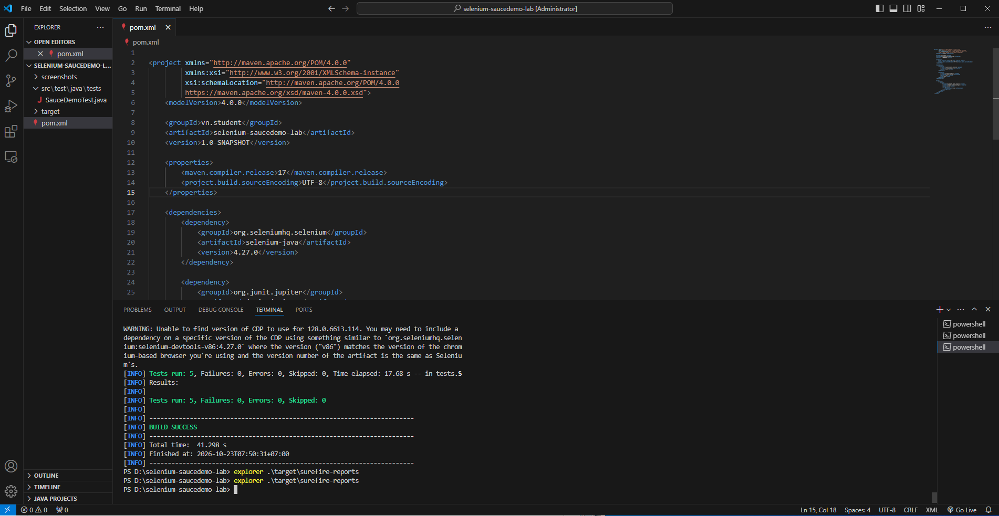
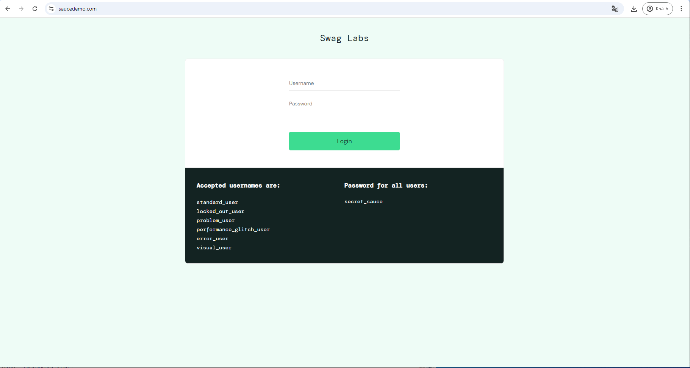
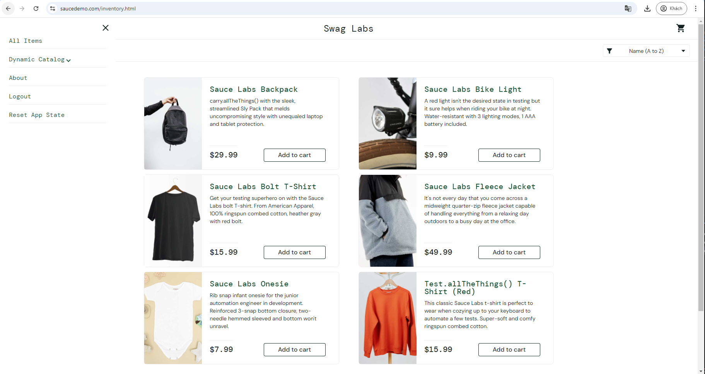
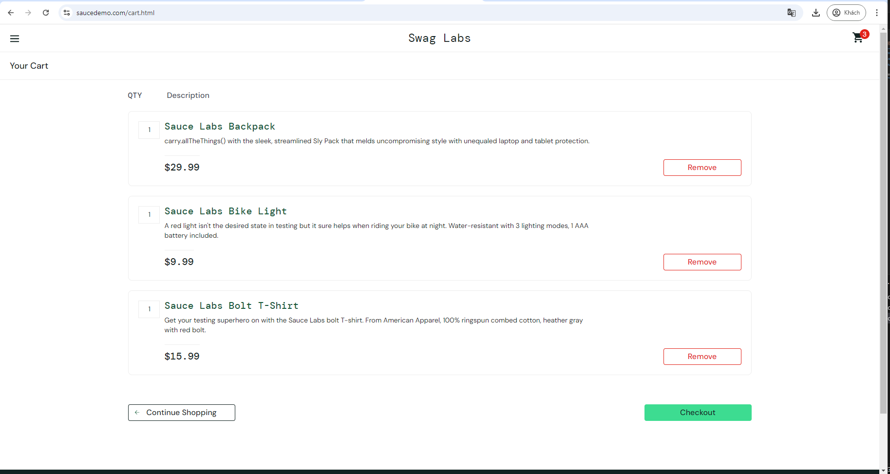

# BÁO CÁO KIỂM THỬ TỰ ĐỘNG VỚI SELENIUM WEBDRIVER

## 1. Thông tin sinh viên

- **Họ và tên:** Ngô Thị Minh Phương
- **Mã sinh viên:** 23012156
- **Tên đề tài:** Kiểm thử chức năng website bằng Selenium WebDriver
- **Website kiểm thử:** https://www.saucedemo.com/

## 2. Giới thiệu đề tài

Đề tài thực hiện kiểm thử chức năng tự động cho website SauceDemo – một website thương mại điện tử được sử dụng để thực hành kiểm thử phần mềm.

Dự án sử dụng Selenium WebDriver để tự động hóa các thao tác trên trình duyệt, bao gồm đăng nhập, kiểm tra thông báo lỗi, thêm sản phẩm vào giỏ hàng, xác minh nội dung giỏ hàng và đăng xuất.

Thông qua đề tài, sinh viên có cơ hội thực hành xây dựng các test case, sử dụng công cụ kiểm thử tự động và đánh giá kết quả thực thi.

## 3. Mục tiêu

- Tìm hiểu và thực hành Selenium WebDriver.
- Xây dựng các test case kiểm thử chức năng website.
- Kiểm tra chức năng đăng nhập với thông tin hợp lệ và không hợp lệ.
- Kiểm tra chức năng thêm sản phẩm và xác minh giỏ hàng.
- Kiểm tra chức năng đăng xuất.
- Sử dụng Maven để quản lý thư viện và thực thi các bài kiểm thử.
- Tổng hợp kết quả kiểm thử và lưu ảnh minh chứng.

## 4. Công nghệ và công cụ sử dụng

| Công nghệ / Công cụ | Mục đích |
|---|---|
| Java 20 | Ngôn ngữ lập trình viết test case |
| Selenium WebDriver 4.27.0 | Tự động hóa thao tác trên trình duyệt |
| JUnit 5 | Xây dựng và thực thi các bài kiểm thử |
| Apache Maven 3.10.0 | Quản lý thư viện và chạy kiểm thử |
| Google Chrome | Trình duyệt thực hiện kiểm thử |
| Visual Studio Code | Môi trường viết và quản lý mã nguồn |
| Git và GitHub | Quản lý phiên bản và lưu trữ dự án |

## 5. Các trường hợp kiểm thử

Dự án xây dựng 5 test case kiểm thử các chức năng chính của website SauceDemo.

| Mã test case | Nội dung kiểm thử | Kết quả mong đợi |
|---|---|---|
| TC01 | Đăng nhập bằng tài khoản hợp lệ | Đăng nhập thành công và chuyển đến trang sản phẩm |
| TC02 | Đăng nhập với mật khẩu không hợp lệ | Website hiển thị thông báo lỗi |
| TC03 | Thêm sản phẩm Sauce Labs Backpack vào giỏ hàng | Biểu tượng giỏ hàng hiển thị số lượng 1 |
| TC04 | Kiểm tra nội dung giỏ hàng | Giỏ hàng có sản phẩm Sauce Labs Backpack |
| TC05 | Đăng xuất khỏi hệ thống | Người dùng được chuyển về trang đăng nhập |

## 6. Quy trình thực hiện

### Bước 1: Chuẩn bị môi trường

Cài đặt Java JDK, Apache Maven, Google Chrome và Visual Studio Code.

### Bước 2: Xây dựng dự án

Tạo dự án Maven, khai báo các thư viện Selenium WebDriver và JUnit 5 trong file `pom.xml`.

### Bước 3: Viết test case

Sử dụng Selenium WebDriver để tự động hóa các thao tác trên website. Sử dụng JUnit 5 để kiểm tra kết quả thực tế so với kết quả mong đợi.

### Bước 4: Thực thi kiểm thử

Mở Terminal tại thư mục gốc của dự án và chạy lệnh:

```bash
mvn clean test
```

Maven sẽ biên dịch mã nguồn kiểm thử, thực thi các test case và tạo báo cáo kết quả.

### Bước 5: Kiểm tra kết quả

Đối chiếu kết quả thực tế với kết quả mong đợi, kiểm tra số lượng test thành công và lưu ảnh minh chứng.

## 7. Kết quả kiểm thử

Sau khi thực thi lệnh `mvn clean test`, hệ thống trả về kết quả như sau:

| Chỉ tiêu | Kết quả |
|---|---:|
| Tổng số test case | 5 |
| Số test thất bại | 0 |
| Số test phát sinh lỗi | 0 |
| Số test bị bỏ qua | 0 |
| Kết quả xây dựng | BUILD SUCCESS |

**Đánh giá:** Cả 5 test case đều được thực thi thành công, không có test thất bại, không phát sinh lỗi và không có test bị bỏ qua.

## 8. Ảnh minh chứng

Thư mục `screenshots/` chứa các ảnh minh chứng cho quá trình kiểm thử, bao gồm:

## Screenshots

### 8.1. Test Execution Results

Ảnh minh chứng kết quả thực thi các test case tự động bằng Selenium trên Terminal.



### 8.2. SauceDemo Login Page

Giao diện đăng nhập của website SauceDemo được sử dụng trong quá trình kiểm thử.



### 8.3. Products Page

Giao diện danh sách sản phẩm sau khi đăng nhập thành công, phục vụ kiểm thử các thao tác với sản phẩm.



### 8.4. Shopping Cart

Giao diện giỏ hàng sau khi thêm sản phẩm, dùng để kiểm tra sản phẩm đã được thêm chính xác vào giỏ hàng.



## 9. Báo cáo kiểm thử tự động

Sau khi chạy kiểm thử bằng Maven, báo cáo được tạo trong thư mục:

`target/surefire-reports/`

Thư mục này chứa kết quả thực thi các test case, bao gồm số lượng test đã chạy, số test thất bại, số lỗi và số test bị bỏ qua.

## 10. Kết luận

Thông qua đề tài, sinh viên đã thực hành xây dựng và thực thi kiểm thử chức năng tự động cho website SauceDemo bằng Selenium WebDriver, Java, JUnit 5 và Maven.

Dự án đã kiểm thử các chức năng đăng nhập, xử lý đăng nhập không hợp lệ, thêm sản phẩm vào giỏ hàng, xác minh giỏ hàng và đăng xuất. Kết quả ghi nhận cả 5 test case đều chạy thành công.

Đề tài giúp củng cố kiến thức về kiểm thử phần mềm, tự động hóa thao tác trên trình duyệt và quản lý kết quả kiểm thử.
